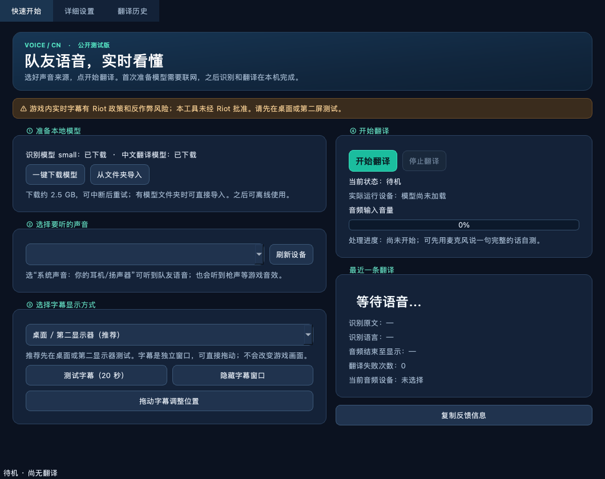

# 队友语音实时翻译器 · Windows 公开测试版原型

Windows 10/11 桌面原型。监听用户选定的系统播放设备或麦克风，将英语、马来语、印地语、泰米尔语、泰语语音离线识别并翻译成简体中文；检测到中文时直接显示简体中文字幕。首次下载模型需要联网；之后推理使用本地文件，不上传语音、文字或游戏数据，也不需要注册。

## 当前完成度

已实现系统音频 WASAPI loopback 设备枚举和采集、WebRTC VAD 分段、faster-whisper 自动语种识别、M2M100 本地翻译、字幕窗口、中文 GUI、术语表、任务过期和重复抑制、GPU 检测与 CPU 回退、模型明确下载按钮。默认是普通桌面窗口模式；透明置顶模式仅使用 Windows 窗口机制。

技术取舍：使用 SoundCard 而非 sounddevice，是为了通过其设备枚举直接选择 Windows WASAPI 回环；使用 WebRTC VAD 而非 Silero，是为了让语音门控轻量且无需运行时联网取权重；M2M100 使用 Transformers/PyTorch 本地推理，以保留官方模型与语言码加载流程。识别仍通过 faster-whisper/CTranslate2 使用 RTX CUDA，翻译通过 PyTorch CUDA。`PySide6-Essentials` 提供本项目所需的 Qt Widgets，省去无关 WebEngine 组件。

用户反馈 Windows 上的 GUI 和翻译现已能运行；**当前开发环境未独立验证新安装包、RTX 性能、游戏内覆盖或长时间稳定性，也没有发布已验证的可执行文件。** 不要把本原型或覆盖层视为 Riot 官方批准的软件。Riot 的 VALORANT 政策列出可能即时改变玩家行为的游戏内实时数据覆盖层作为未获批准的用例；语音实时翻译是否属于该类需 Riot 明确判断。建议先在桌面或第二显示器使用。程序不读取游戏内存、不注入、不 Hook、不修改游戏文件，也不绕过 Vanguard。



## 普通测试者安装（Windows 构建完成后）

下载 `VoiceCNTranslator_Beta_Setup.exe` 安装，或下载 `ValorantTranslator_Portable.zip` 解压后双击 `ValorantTranslator.exe`。这两种构建产物的目标是**不用安装 Python**。目前只有构建脚本，没有在 Windows 上生成并验证的安装包；请先按 [公开测试指南](PUBLIC_BETA_GUIDE_CN.md) 完成 Windows 验证再对外提供下载。

首次打开点击“一键下载模型”，等下载完成。也可点“从文件夹导入”，选择已经下载的完整识别模型、翻译模型文件夹，或同时包含两者的上级文件夹。模型不包含在安装包中，用户点击后才下载。之后选系统声音设备、测试字幕、开始翻译。

安装版首页现有“检查更新”按钮：发布者配置公开 GitHub 仓库并附上新版安装包后，测试者可以点击检查、下载校验并打开安装程序。软件**不会后台自动下载或安装**；没有仓库配置时按钮会明确提示。首次带更新功能的 EXE 仍需手动发给旧版用户。具体发布流程与未验证项见 [私聊测试包及更新指南](UPDATE_RELEASE_GUIDE_CN.md)。

## 源码开发安装

1. 安装 Python 3.11 或 3.12 的 64 位版本、NVIDIA 显卡驱动。使用 Windows 10/11。启动脚本会依次尝试 Windows Python Launcher 与 `python` 命令。
2. 双击 `start_windows.bat`。它创建 `.venv` 并安装 `requirements.txt` 后启动界面。
3. 在“快速开始”第 ① 步点击“一键下载模型”。可在“详细设置”选择 `small`（速度较快）或 `base`（更省显存）。Whisper small 约数百 MB；M2M100 418M 约 2 GB，磁盘需预留空间。旧版 NLLB 模型不能代替新版 M2M100，需要重新下载或导入后者。
4. 在第 ② 步选择带“系统声音”前缀的播放设备，在第 ③ 步先选桌面模式并点“测试字幕（20 秒）”。确认预览后，在第 ④ 步点击“开始翻译”。游戏声音照常播放。
5. 断网复测：下载完成后，关闭网络，再运行软件。模型应从 `%LOCALAPPDATA%\ValorantTranslator\models` 加载。

已有旧版的用户可按 [UPGRADE_CN.md](UPGRADE_CN.md) 覆盖更新；无需重装 Python，Whisper 模型可继续使用，但需要下载或导入新的 M2M100 翻译模型。

### 短报点与游戏用语

`config/glossary.json` 独立保存识别提示词、常见报点、位置别名和中文替换词。完整匹配的英文游戏短句直接显示固定译文，可减少机器翻译对 `Can you drop?` 之类句子的误译；未匹配的普通句子仍交给本地 M2M100。术语提示词只是帮助 Whisper 解码，不保证口音、混合语言或背景音下都能识别正确。按需求修改词库后需要重启翻译。

词库现包含 Riot 页面列出的枪械和英雄英文名、常见简称、封烟报点及名称误译修正；完整清单在 [术语审核表](GAME_TERMS_REVIEW_CN.md)，可填写 [CSV 反馈表](GAME_TERMS_REVIEW.csv)。`They smoke B` **识别正确时**会显示“他们在往 B 点封烟。”；若音频被听成 `They won't be`，程序会过滤该不完整片段，不会猜测为封烟。改善这种识别错词需要带参考原文的获许可音频。新词库不会保证所有枪名、英雄名或口音都能听对。

中文语音不会进入外语机器翻译模型，而是直接转换为简体字显示。自动检测中文仍依赖 Whisper；若本局主要说中文，可在“详细设置”锁定“中文（直接显示）”。如果主要是英语口音，可锁定英语；有足够显存时可下载 `medium` 识别模型并关闭低延迟模式对比，但会增加等待时间。

独立的 `A` 与英语冠词/语气词在极短音频中难以可靠区分，程序会过滤这类不确定输出，不会猜成 `A 点`。测试时优先使用 `A main`、`A site` 等完整报点。若短语音经常被过滤，在“详细设置”把“语音检测严格度”设为 `1`；若游戏音效误触发过多，调回 `2`。旧版已保存的设置不会被更新覆盖。

新版本将识别与翻译分成独立工作线程，常见英语报点可直接使用词库译文。例如 `Go rush A → 快攻 A。`，`Rotate B → 转点去 B。`。两句语音接连出现时，下一句可在上一句翻译时开始识别；队列仍有容量和过期时间限制，长时间超负荷时会提示丢弃旧句。真实延迟须在目标 Windows 电脑测量。

### 口语化中文

对识别正确的常见队友短句，词库会直接使用口语化译文，例如 `Give me a moment → 等我一下。`、`Hold on a second → 等一下。`、`I'm reloading → 我在换弹。`、`Wait for me → 等我一下。`。带有 `please` 等简单变体也有整句规则。较长句子仍使用本地 M2M100；对少量已知直译（例如“给我一瞬间”）只在原文包含对应独立分句时做上下文修正。不会把所有机器翻译自动改写成游戏口语，也不会凭猜测补充位置、人数或行动。若有不自然译文，请从“翻译历史”复制原文和译文，并用“修正选中译文”保存个人译法；历史记录不会自动上传。

### 翻译历史与个人修正

“翻译历史”页显示最近 100 条记录，包含识别原文、中文字幕、语种和音频结束至显示的延迟。数据库在 `%LOCALAPPDATA%\ValorantTranslator\history.sqlite3`，最多保留 1000 条；“导出 CSV”会导出当前保留的全部记录。选中一条点“修正选中译文”，同样的识别原文和语种以后会优先使用这条修正。历史仅保存文字与耗时，**不保存或上传音频**。在“详细设置”可关闭继续保存历史；“清空历史”保留个人修正，“删除历史和修正”会一并清除。

口音较重的英语可能导致 Whisper small 漏词。若本局主要说英语，可在“详细设置”暂时锁定英语，避免自动语种误判；多语环境请恢复自动检测。`medium` 模型可作为更大容量的识别选项，但会增加计算与显存需求，不能保证一定识别准确。

首次通过 `start_windows.bat` 安装依赖并确认 GUI 正常后，双击同目录中的 `create_shortcut_windows.vbs`，它会在 Windows 桌面创建 `Valorant Translator` 快捷方式。以后双击桌面快捷方式即可直接打开 GUI，不显示命令行窗口。若快捷方式无反应，可再运行启动脚本查看错误，或查看 `%LOCALAPPDATA%\ValorantTranslator\app.log`。

如需排查显卡与设备，在项目根目录运行 `.venv\Scripts\python.exe -m scripts.diagnose`，输出包括 NVIDIA 驱动、CTranslate2/PyTorch CUDA 状态和音频设备清单。

模型下载按钮会从 Hugging Face 获取 `Systran/faster-whisper-small`（或所选大小）与 `facebook/m2m100_418M`。这些操作只在用户点击后发生。可将已下载的同名模型目录复制到上述 `models` 目录，以完成离线导入。

### NVIDIA GPU

识别使用 CTranslate2 CUDA，翻译使用 PyTorch CUDA。推荐 CUDA 12 与 cuDNN 9 的对应运行库；主界面“实际运行设备”会分别显示识别和翻译使用的是 CUDA 还是 CPU。CUDA 缺失时会自动回退 CPU。显存不足时识别优先尝试已下载的较小模型，再回退 CPU；翻译回退 CPU。CPU 下延迟可能明显超过 2–5 秒。设置中的“GPU”也会安全回退，不保证显卡可用。默认开启低延迟模式，使用较小的解码搜索宽度；如遇到更多错词，可在“详细设置”关闭低延迟模式进行对比。

### 音频设备选择

选择“系统声音：扬声器/耳机”即 WASAPI loopback，它采集该输出设备的所有声音，**无法自动分离队友语音与枪声脚步声**。如果设备列表没有输出设备，先在 Windows 声音设置确认其启用并点“刷新设备”。拔掉设备时会提示错误并每 2 秒重试；重新插入同一设备后继续采集。更换设备可以在设置中选择新设备，程序会重启流水线。

可选：使用用户自行安装的虚拟音频设备，将游戏语音聊天输出单独指向虚拟设备，再在本软件选它的回环设备。不同虚拟声卡及 VALORANT 的聊天输出设置需在本机核验；这不是本程序自动完成的功能。若没有独立路由，使用普通系统回环兼容模式。

### 字幕设置

默认普通窗口，方便桌面和第二显示器测试。主界面第 ③ 步可切换到“游戏窗口覆盖（实验）”：这是无边框透明 Windows 置顶窗口，不使用注入或游戏 Hook。拖动字幕窗口或在“详细设置”输入 X/Y；可选显示原文、字号、背景不透明度、鼠标穿透。全局快捷键默认 `Ctrl+Shift+T`；如果被系统或其他软件占用，可在设置更改。最多显示最近两条，显示时长可调整。多显示器可以选目标显示器，Qt 负责 DPI 缩放，但不同 DPI 的 Windows 实测尚未完成。

字幕窗口现在按目标显示器限制宽高；长字幕会优先保留最新一条、缩小显示字号，必要时在窗口中省略尾部，完整译文仍保留在“翻译历史”。这避免了两条长字幕把游戏窗口覆盖层突然撑大。macOS 离屏窗口已验证尺寸固定，Windows 多 DPI 仍待实测。

### 想边玩边看字幕：实验模式

1. **先在桌面测试**：点“测试字幕（20 秒）”，确认能看到独立字幕窗口，音频音量条会随所选设备播放声音变化。
2. 在 VALORANT 的画面设置中选择“无边框窗口”或“窗口化全屏”（不同语言客户端名称可能不同），避免独占全屏。
3. 在本软件第 ③ 步选择“游戏窗口覆盖（实验）”，点“测试字幕（20 秒）”，再切回游戏观察能否看到。这个模式使用普通 Windows 置顶窗口，**不保证**在游戏上方显示。
4. 要移动字幕，回到软件点“调整位置（暂时关闭穿透）”，拖动预览字幕到不会遮挡准星、小地图及其他重要区域的位置，再点“完成调整（开启穿透）”。也可用“详细设置”里的显示器和 X/Y 精确定位。
5. 点“开始翻译”，然后切回游戏。默认按 `Ctrl+Shift+T` 可显示或隐藏字幕；在“详细设置”可改快捷键。
6. 如果始终看不到字幕，使用桌面或第二显示器模式。不要尝试用注入、Hook 或绕过 Vanguard 的方法强行显示。

Riot 的开发者政策将某些可能即时影响玩家行为的实时游戏内覆盖层列为未获批准的示例；本软件的实时翻译是否属于该类未获 Riot 确认。使用游戏内实验模式前应自行评估风险。[Riot VALORANT 政策](https://developer.riotgames.com/docs/valorant)。

## 测试

安装后在项目根目录运行：

```bat
.venv\Scripts\python.exe -m pytest -q
```

五语真实音频基准：将**本人录制或获得明确许可**的 16 kHz、单声道、16-bit PCM WAV 放入 `test_audio`，每份对应一个人工核对的参考原文和中文参考译文。复制 `test_audio/manifest.example.json` 为 `test_audio/manifest.json`，按实际音频修改，随后运行：

```bat
.venv\Scripts\python.exe -m scripts.benchmark test_audio\manifest.json --output benchmark_results.csv
```

请对照参考文本人工评价准确率；脚本记录 ASR、翻译、总耗时、RAM、CPU 和可用时的 NVIDIA 显存。实时端到端延迟还需在 GUI 里测量，当前显示的是“音频结束至显示”，不包含说话持续时间。无语音、游戏音效、多语言切换、音频设备切换、GPU 回退、无网、快捷键、第二显示器和一小时稳定性需按 `TEST_PLAN_CN.md` 逐项实测。

## Windows 打包

要制作带软件内更新功能的测试安装包，先按 [更新发布指南](UPDATE_RELEASE_GUIDE_CN.md) 配置 GitHub 仓库；没有仓库地址时脚本会停止，避免发出更新按钮无效的安装包。然后在 Windows 上双击 `make_public_installer_windows.bat`。它会准备依赖、生成便携版，并尝试通过 Windows `winget` 安装 Inno Setup 6，随后生成单文件安装程序 `dist\VoiceCNTranslator_Beta_Setup.exe`。若 `winget` 不可用，仍会留下 `dist\ValorantTranslator_Portable.zip`；装好 Inno Setup 6 后重新双击即可。也可将源码放进 GitHub 仓库后手动运行 `.github/workflows/windows-beta.yml`。这些都是**待验证**构建步骤；当前 macOS 环境不能交付已验证的 Windows EXE。模型目录不包含在安装包中，首次使用仍需显式下载或导入。

## 常见问题

- “识别/翻译模型缺失”：先点击下载按钮，确认下载完成；离线导入时目录名必须与设置一致。
- “CUDA 运行库缺失”：更新 NVIDIA 驱动，安装匹配的 CUDA 12/cuDNN 9 运行库，或选 CPU。
- “torch.load 要求 PyTorch 至少 2.6”：旧包允许安装较低版本，这是已修复的依赖约束。进入项目目录运行 `.venv\Scripts\python.exe -m pip install --upgrade "torch>=2.6,<3"` 后重启，无需重新下载模型。若 PyTorch CUDA 仍不可用，按 PyTorch 官方 Windows 安装选择器安装适合显卡的 CUDA 版。
  也可将 `repair_torch_windows.bat` 放在项目根目录，双击进行相同的更新。更新时先关闭翻译器窗口。
- 只有游戏音效没有语音：回环监听的是整个输出设备；检查游戏语音聊天是否从其他设备输出。
- 完全没有音量：换设备、刷新设备，并检查 Windows 音量混合器。
- 字幕在游戏上不可见：独立窗口在独占全屏下不保证显示；改用无边框窗口游戏、桌面或第二显示器。不要尝试绕过 Vanguard。
- 识别混合语种或短词有误：手动锁定主要语言；不确定时程序会抑制低置信度短句，但不能保证绝无错译。
- 音量条会跳动但没有字幕：先看第 ② 步是否误选了“麦克风”。截图中的麦克风设备只能听到麦克风输入；队友语音要选实际播放它的“系统声音：耳机/扬声器”。音量条只代表所选设备有声音，游戏音效也会使它跳动。若进度一直显示“等待语音”，可临时选“麦克风”，清楚说一段 2–3 秒英语并停顿一秒自测；若显示“未得到可靠文字”，可说完整句或锁定语言；若显示“字幕已过期”，检查 GPU 状态或调整超时。麦克风自测后记得切回“系统声音”。

完整排查流程见 [DIAGNOSE_CN.md](DIAGNOSE_CN.md)。

## 许可证与风险

实时版已改用模型页标注 **MIT** 的 M2M100 418M；旧版 NLLB 不再下载、加载或打包。主要模型来源见 [第三方来源说明](THIRD_PARTY_NOTICES_CN.md)。仍需按各依赖的许可证保留相应声明，并在公开分发前实测五语质量、延迟和 Windows 安装流程。模型许可的调整**不等于** Riot 批准游戏内字幕。

参考：[M2M100 模型卡](https://huggingface.co/facebook/m2m100_418M)、[faster-whisper CUDA 说明](https://github.com/SYSTRAN/faster-whisper)、[SoundCard WASAPI 说明](https://soundcard.readthedocs.io/en/stable/)、[Riot VALORANT 政策](https://developer.riotgames.com/docs/valorant)、[Vanguard 第三方应用 FAQ](https://www.riotgames.com/en/DevRel/vanguard-faq)。
